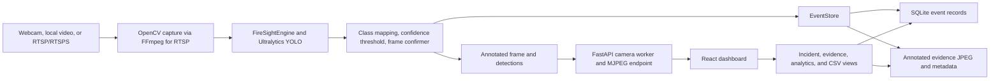

# FireSight AI

 FireSight AI is a local-first computer-vision application that analyzes webcam, video-file, and RTSP/RTSPS camera streams, displays annotated frames, and records confirmed fire and smoke events with evidence images.

The repository includes a React dashboard, a FastAPI service, a desktop Tkinter interface, a YOLO inference engine, and offline evaluation and runtime-benchmark tools. It is intended as an inspectable development and demonstration project; it is not a certified fire-alarm system or a substitute for code-compliant life-safety equipment.

> **Branch:** the dashboard and current CCTV work described here are on `feature/production-dashboard`. The default `main` branch may not contain them yet.

## Contents

- [Capabilities](#capabilities)
- [Screenshots](#screenshots)
- [Architecture](#architecture)
- [Technology](#technology)
- [Quick start on Windows](#quick-start-on-windows)
- [Models and datasets](#models-and-datasets)
- [CCTV and RTSP setup](#cctv-and-rtsp-setup)
- [Configuration reference](#configuration-reference)
- [API overview](#api-overview)
- [CI and deployment preparation](#ci-and-deployment-preparation)
- [Tests and evaluation](#tests-and-evaluation)
- [Troubleshooting](#troubleshooting)
- [Repository map](#repository-map)
- [Development notes and roadmap](#development-notes-and-roadmap)
- [Contributing](#contributing)
- [License and acknowledgements](#license-and-acknowledgements)

## Capabilities

| Capability | Status | Notes |
|---|---|---|
| Fire, person, and smoke detections | Implemented | Inference requires model class IDs `{0: fire, 1: person, 2: smoke}`. Fire and smoke can produce confirmed events; person is displayed as a detection. |
| Live sources | Implemented | Webcam device index, local video, RTSP, and RTSPS through OpenCV's FFmpeg backend where available. One inference source is active at a time. |
| Dashboard | Implemented | Overview, live monitor, camera sources, incidents/events, evidence, analytics/export, alerts, health, and settings. |
| Detection display | Implemented | Annotated live MJPEG frames, class labels, confidence scores, source state, and frame/inference information. |
| Event and evidence storage | Implemented | Confirmed events are stored in SQLite with annotated JPEG evidence and JSON metadata under the configured evidence folder. |
| Camera configuration persistence | Implemented | Names, source types, and redacted source information are in an ignored local registry. RTSP endpoints, including authentication and query parameters, are stored separately using Windows DPAPI. |
| RTSP test and diagnostics | Implemented, backend-dependent | Test requires a decoded frame. Host/port, timeout, and several open/path/authentication failures receive actionable diagnostics; OpenCV may not distinguish camera authentication from path errors. |
| Reconnection | Implemented, bounded | RTSP worker retries according to the setting (default 2, maximum 10) with short incremental backoff. It is not an indefinite reconnect service. |
| Model evaluation and runtime measurement | Implemented | `firesight.evaluation` and `firesight.benchmark` produce local reports. No accuracy or deployment performance claim is made here. |
| External alert delivery, multi-camera inference, user authentication | Not implemented | UI/event queue does not send email, Telegram, webhook, or push notifications. |

## Screenshots

No genuine application screenshots or demo recordings are currently checked in. To capture one, run the dashboard using the steps below, wait for the model and a non-sensitive local/test source to be ready, then use Windows Snipping Tool. Before committing an image, inspect it for private camera labels, network addresses, credentials, and event evidence. Do not use a private CCTV feed as a public demo image.

## Architecture



The dashboard calls the loopback FastAPI service. `firesight/api.py` owns the camera registry, API routes, and bounded capture workers. `firesight/engine.py` opens sources and applies the shared YOLO model and event confirmer. `firesight/events.py` sanitizes source identifiers and persists confirmed events/evidence. The browser receives preview frames and event metadata; it does not open RTSP directly. Camera and application state are local to the machine.

## Technology

- Python 3.12 environment, FastAPI, Pydantic, and Uvicorn.
- Ultralytics YOLO, PyTorch, NumPy, Pillow, and OpenCV.
- React 19, TypeScript, Vite 8, and pnpm for the dashboard.
- SQLite and local files for events/evidence.
- Windows DPAPI for per-user camera-secret protection. There is no plaintext fallback.
- OpenCV's FFmpeg backend is used for RTSP capture. MediaMTX and FFmpeg command-line tools may be used for an optional local test stream; they are not required for webcam/video inference.
- Python `unittest` and the TypeScript/Vite production build are the checked-in validation paths. There is no frontend unit-test script or CI workflow in this branch.

## Quick start on Windows

The commands below target Windows PowerShell, Python 3.12, and the feature branch containing this dashboard. A compatible PyTorch build depends on the host's CPU/GPU and CUDA setup; see the PyTorch note below.

### Clone and create the Python environment

```powershell
git clone --branch feature/production-dashboard https://github.com/navaneeth-7-oss/FireSight-AI.git
Set-Location FireSight-AI
py -3.12 -m venv .venv
```

### Install dependencies

```powershell
.\.venv\Scripts\python.exe -m pip install --upgrade pip
.\.venv\Scripts\python.exe -m pip install -r requirements.txt
.\.venv\Scripts\python.exe -m pip install -r requirements-api.txt
```

`requirements.txt` pins the repository's recorded local versions, including PyTorch and OpenCV. If the pinned PyTorch wheel does not match the target machine, install the PyTorch build appropriate to that machine before installing the remaining requirements, and record any environment-specific adjustment. CPU inference is selected by Ultralytics automatically when CUDA is unavailable; expect different throughput. No CUDA device is required by the inference code.

Install the frontend using a supported Node.js version (Vite 8's lockfile declares Node `^20.19.0` or `>=22.12.0`) and Corepack pnpm:

```powershell
Set-Location frontend
corepack pnpm install --frozen-lockfile
Set-Location ..
```

### Start the API and dashboard

Use two PowerShell terminals from the repository root.

Terminal 1 — API on `127.0.0.1:8765`:

```powershell
.\.venv\Scripts\python.exe -m firesight.api
```

Terminal 2 — Vite dashboard on `127.0.0.1:5173`:

```powershell
Set-Location frontend
corepack pnpm dev
```

Open <http://127.0.0.1:5173>. API liveness is at <http://127.0.0.1:8765/api/health>; interactive development docs are at <http://127.0.0.1:8765/docs>. The API serves `frontend/dist` from its root if a production build exists. To build it:

```powershell
Set-Location frontend
corepack pnpm build
```

The original desktop interface can be started separately with `.\.venv\Scripts\python.exe firesight_app.py` from the repository root.

### Configuration basics

Defaults live in `firesight/config.py`; environment variables override the supported settings. The application reads the process environment directly and does not automatically load `.env.example` as a dotenv file. In PowerShell, set a variable for the current process before starting the API, for example:

```powershell
$env:FIRESIGHT_MODEL_PATH = 'models/best.pt'
$env:FIRESIGHT_CONFIDENCE_THRESHOLD = '0.4'
.\.venv\Scripts\python.exe -m firesight.api
```

See [Configuration reference](#configuration-reference). Do not put real camera credentials into shell history, tracked files, or shared screenshots.

## Models and datasets

The API and desktop app default to `models/best.pt`, which is present in this repository (about 5.5 MB in the current checkout). At startup, `FireSightEngine.load_model()` checks the loaded model's class mapping and refuses models whose IDs/names do not match `{0: fire, 1: person, 2: smoke}`. Override the model path with `FIRESIGHT_MODEL_PATH` or the ignored local `firesight_config.json`.

`models/drowning_best.pt` is also tracked but is not used by the FireSight default inference path. The root `yolo11n.pt` and `yolo26n.pt` files are tracked model artifacts; `train.py` initializes from `yolo11n.pt`. The training script currently contains machine-specific dataset and output paths and requests GPU device `0`; it is not a clone-ready training command. Update those local paths and the device choice before using it.

The `dataset/` folder is ignored and is not required for inference. Evaluation and training require a local labeled dataset with the expected YOLO format and class order `[fire, person, smoke]`; the repository does not provide a verified dataset download URL. Dataset and external weight use may have separate licensing/attribution requirements. Verify the provenance and terms for the exact artifacts you use.

No full-dataset accuracy, validation score, or benchmark result is claimed by this README. Run evaluation against a suitable labeled dataset before interpreting thresholds or suitability.

## CCTV and RTSP setup

In **Camera Sources** or the Overview source form, select RTSP/RTSPS, enter a display name and a complete endpoint such as `rtsp://<camera-host>:554/<camera-stream-path>`, and optionally enter the username and password separately. You can also supply a complete URL containing embedded user information for compatibility; credentials from separate fields are URL-encoded correctly, including special characters. Avoid including secrets in screenshots, shell commands, or support logs.

Use **Test connection** before saving. A successful test means the backend opened the source and decoded at least one frame; a TCP port being reachable alone is not sufficient. Save then connect to start inference. Disconnect stops the worker. A source can be edited while disconnected; entered endpoint/credential changes are tested before being saved. Leave the endpoint blank when editing to retain it.

Camera names, kinds, and sanitized sources persist in `runs/firesight/api_cameras.json`. RTSP URLs are kept in `runs/firesight/api_camera_secrets.json` only as Windows DPAPI protected blobs, tied to the Windows user account that protected them. The encrypted value includes the full URL, preserving required path and query parameters. Camera API responses omit source URLs and credentials. Do not copy only the camera registry to another machine/user and expect DPAPI secrets to work; the protected secret file and the same Windows account/profile are needed for recovery. If DPAPI is unavailable or a secret cannot be recovered, the service reports the limitation and does not store plaintext.

Legacy camera registry records are loaded safely. Legacy full URLs are migrated into DPAPI storage on registry save/startup when protection is available. If secure storage fails, the source is sanitized and the API marks the camera with an error instead of exposing the legacy credential or silently persisting plaintext. The owner may need to enter credentials again after migration/storage failure.

The RTSP capture path uses OpenCV's FFmpeg backend with bounded open/read timeouts when supported. Probe diagnostics distinguish some host-resolution, refused-port, timeout, and generic stream-open/frame failures. Many cameras do not reveal whether a generic open failure means bad authentication or wrong channel/path; verify both in the camera's local configuration. RTSP worker reconnection is bounded and configurable.

For local integration testing, a developer may run MediaMTX with a test publisher using FFmpeg, then enter the local test endpoint in the UI. Keep the test server and API on trusted loopback/LAN interfaces. The API has no authentication or TLS and binds to loopback by default; do not expose it or private camera streams directly to the public internet.

## Configuration reference

`firesight_config.json` is a local, ignored JSON settings file written by the desktop settings UI. Its absence is normal. Process environment overrides are read by `firesight/config.py`; `.env.example` is documentation only and is not auto-loaded.

| Setting | Purpose | Default | Required? |
|---|---|---|---|
| `FIRESIGHT_MODEL_PATH` | YOLO weights path, relative to project root unless absolute | `models/best.pt` | Required model file |
| `FIRESIGHT_CONFIDENCE_THRESHOLD` | Detection score threshold | `0.4` | Optional, 0–1 |
| `FIRESIGHT_CONFIRMATION_FRAMES` | Consecutive positive frames required to confirm fire/smoke | `3` | Optional, at least 1 |
| `FIRESIGHT_SOURCE` | Default local source (file path or webcam index) | Empty | Optional |
| `FIRESIGHT_RTSP_URL` | Default RTSP source for the desktop configuration | Empty | Optional; use secure camera UI for stored credentials |
| `FIRESIGHT_EVIDENCE_DIR` | Evidence image/metadata directory | `runs/firesight/evidence` | Optional |
| `FIRESIGHT_EVENT_DB` | SQLite event database path | `runs/firesight/events.sqlite3` | Optional |
| `FIRESIGHT_DETECTION_LOG` | JSON-lines detection log path | `runs/firesight/detections.jsonl` | Optional |
| `FIRESIGHT_OUTPUT_VIDEO_DIR` | Processed video output directory | `runs/firesight/processed_video` | Optional |
| `FIRESIGHT_INTERNAL_ALERTS` | Enables internal event handling setting | `true` | Optional |
| `FIRESIGHT_EXTERNAL_ALERTS` | Requests external-alert mode | `false` | Optional; no provider is implemented |
| `FIRESIGHT_CORS_ORIGINS` | Comma-separated exact browser origins allowed by the API | `http://127.0.0.1:5173,http://localhost:5173` | Optional; do not use `*` |

The dashboard also persists `confidence_threshold`, `confirmation_frames`, and `reconnect_attempts` in ignored `runs/firesight/api_settings.json`. `reconnect_attempts` defaults to `2` and is constrained to 0–10. `max_active_sources` is currently fixed at one. These are API settings, not `FIRESIGHT_*` environment variables.

## API overview

The development API is local and unauthenticated. Keep it on loopback and do not treat these routes as a public service contract. Request/response details are available at `/docs` while the API is running.

| Method and path | Purpose |
|---|---|
| `GET /api/health`, `GET /api/system/status` | Process and model/storage status. |
| `GET/POST /api/cameras`, `GET/PATCH/DELETE /api/cameras/{id}` | List and manage camera metadata. Secret values are accepted on writes but omitted from responses. |
| `POST /api/cameras/test`, `POST /api/cameras/{id}/test` | Probe an endpoint and require a readable frame. |
| `POST /api/cameras/{id}/connect`, `/disconnect`, `/pause`, `/resume` | Control a configured source. |
| `POST /api/cameras/upload` | Upload and validate a local video (200 MiB limit). |
| `GET /api/cameras/{id}/snapshot`, `/stream` | Latest JPEG and live multipart MJPEG preview. |
| `POST /api/detect/image` | One-off image inference (12 MiB request limit). |
| `GET /api/incidents`, `/api/alerts`, `GET/PATCH /api/incidents/{id}` | Query and update persisted incident state. |
| `GET /api/evidence/{id}` | Preview or download evidence for a persisted event. |
| `GET /api/analytics/summary`, `/api/analytics/export.csv` | Event summary and CSV export. |
| `GET/PATCH /api/settings` | Read/update validated inference and reconnect settings. |

## CI and deployment preparation

[`CI workflow`](.github/workflows/ci.yml) runs on pushes, pull requests, and manual dispatch. [`Repository safety scanner`](scripts/check_repo_safety.py) checks changed-file whitespace/secrets/artifacts; CI imports the FastAPI app and health route, runs the Python suite, and installs the frozen pnpm dependencies before a production build. It does not deploy. Protect `main` in GitHub Settings → Branches: require pull requests, require all three checks (`CI / Repository and secret safety`, `CI / Backend tests and import validation`, `CI / Frontend production build`), and disallow direct pushes or check bypass. The production branch remains `main`; this repository's dashboard work is still on `feature/production-dashboard` until maintainers merge it.

### Vercel frontend

After the dashboard changes are merged into `main`, create a Vercel project using the GitHub repository with **Root Directory** `frontend`, **Production Branch** `main`, build command `pnpm build`, and output directory `dist`. Use Vercel's native Git integration for preview and production builds; no Vercel token or deployment secret is needed in GitHub Actions. Set the frontend project environment variable `VITE_API_BASE_URL` to the HTTPS base URL of the separately hosted API. The blank value in [`frontend/.env.example`](frontend/.env.example) is for local Vite proxy use. A preview frontend requires its own allowed API origin if it needs to call the backend; the backend CORS setting is deliberately an exact allowlist.

Production deployment gating depends on the GitHub branch rule: only merge a PR to `main` after all required checks pass, and prevent bypass/direct pushes. Vercel's production branch must also remain `main`. Preview deployments may be generated for PRs; they are not proof that the backend or CCTV integration works.

### FastAPI backend: current deployment blockers

No backend hosting provider, deployment workflow, or production deployment is configured. The API is unauthenticated, has no built-in TLS, and camera secrets use Windows per-user DPAPI. A public cloud host—especially a Linux host—cannot safely provide the current authenticated-camera behavior: DPAPI is unavailable there, and the API intentionally refuses a plaintext fallback. Do not expose this API to the public internet. Before hosting it, add and review authentication/access control, TLS at a trusted edge, and a secret-store design supported by the selected host. CORS only controls which browsers may read cross-origin responses; it is not authentication or a firewall.

For a private deployment evaluation only, a compatible host can install `requirements.txt` and `requirements-api.txt` and start the ASGI app with a provider-specific command equivalent to `uvicorn firesight.api:app --host 0.0.0.0 --port $PORT`. Set backend environment variables in the host console, including `FIRESIGHT_CORS_ORIGINS` to the exact HTTPS frontend origin. Set frontend `VITE_API_BASE_URL` to the HTTPS API base URL at build time; HTTPS pages cannot use an HTTP API. Keep default loopback CORS origins for local development.

The API writes its camera registry, protected camera-secret file, settings, uploaded videos, SQLite event database, logs, and evidence beneath `runs/firesight/` by default (the evidence, database, detection log, and output-video paths can be configured separately). A host with ephemeral storage loses this state on restart/redeploy. Configure and test a persistent volume before using such a host, back it up, and do not allow deployment scripts to clear it. `models/best.pt` is tracked, but its small file size does not indicate the RAM needed for PyTorch/YOLO. CPU/GPU memory and latency requirements have not been measured; benchmark the exact model on the exact target instance before selecting a host. No free-tier capacity or persistent-storage guarantee is assumed.

The smoke endpoint for a deployed service is `GET /api/health`; it checks process liveness only, not model readiness, storage persistence, authentication, or camera connectivity. Check `/api/system/status` separately after adding deployment security. Never add real provider credentials to the repository; use provider environment settings or narrowly scoped GitHub Actions secrets only if a later reviewed deployment workflow needs them.

### Rollback

For a bad application change merged to `main`, revert it with a new commit (`git revert <commit-sha>`) and let required checks pass before Vercel builds the production branch. Vercel also provides deployment history for selecting a prior successful frontend deployment. Use the selected backend host's deployment history for API rollback. Back up the persistent volume before rollback and verify code/database compatibility; a code rollback must not delete or replace evidence, camera configuration, or the event database.

## Tests and evaluation

From the repository root, run the Python suite:

```powershell
.\.venv\Scripts\python.exe -m unittest discover -s tests -v
```

Tests use temporary storage and mocked video captures; they do not prove operation with a physical camera. There is no frontend unit-test script. Check TypeScript and create a production dashboard bundle with:

```powershell
Set-Location frontend
corepack pnpm build
```

For a real RTSP smoke test, use **Test connection** with a camera/test stream on a trusted network, then connect and confirm frames advance. This requires the actual endpoint, permissions, compatible codec, and network; mocked tests are not a physical CCTV test.

Offline evaluation expects a correctly structured local YOLO dataset and the class mapping above. Example validation threshold sweep:

```powershell
.\.venv\Scripts\python.exe -m firesight.evaluation --data dataset\data.yaml --split val --thresholds 0.15,0.25,0.4,0.55,0.7
```

Reports and bounded review images go to `runs/firesight/evaluations/` by default. Review skipped samples, false positives/negatives, and per-class results. A threshold sweep is a validation aid, not a substitute for an untouched test set or operational qualification.

The runtime benchmark can measure a local video or image directory (not a physical camera/browser deployment):

```powershell
.\.venv\Scripts\python.exe -m firesight.benchmark --source dataset\valid\images --warmup 5 --frames 100
```

Its output is written under `runs/firesight/benchmarks/`. Hardware/network measurements still need to be made on the intended deployment system.

## Troubleshooting

| Symptom | Checks |
|---|---|
| API reports model error | Confirm `FIRESIGHT_MODEL_PATH` points to an existing compatible weights file. The API checks that class mapping is exactly fire/person/smoke. |
| Python import or PyTorch installation failure | Activate/use the intended Python 3.12 environment; reinstall requirements. For PyTorch wheel/CUDA mismatch, install a build matching the target platform from the official PyTorch selector. |
| Dashboard cannot reach API | Start the API on port 8765 and Vite on 5173; check `/api/health`. The Vite proxy targets `127.0.0.1:8765`. |
| Port already in use | Stop the process holding 8765 or 5173 before starting the corresponding service. The API currently uses a fixed loopback port. |
| `pnpm` or Node version failure | Install Node `^20.19.0` or `>=22.12.0`, enable Corepack, then run `corepack pnpm install --frozen-lockfile` in `frontend`. |
| RTSP host cannot be resolved / port unreachable / timeout | Check the camera address, port, local routing/firewall, RTSP service, and that the camera is accessible from this computer. |
| RTSP service opens but no stream/frame | Check authentication, stream path/channel, codec compatibility, and camera channel configuration. VLC success does not guarantee OpenCV/FFmpeg can decode the same stream. |
| RTSP reports generic open failure | Authentication and invalid stream path can be indistinguishable from OpenCV. Verify credentials and channel path directly in the camera configuration. |
| RTSP credentials do not recover | DPAPI data is tied to the Windows user profile that protected it. Run as that account; if protected data is missing/unreadable, re-enter credentials. There is no plaintext recovery fallback. |
| Preview looks pixelated | Inspect the source resolution and stream profile/bitrate in the camera or MediaMTX publisher; the dashboard displays decoded source frames. |
| Dataset/evaluation reports missing samples | The dataset is not included. Set up local split folders and YOLO labels, and ensure the data YAML class order is `[fire, person, smoke]`. |

## Repository map

```text
firesight/                 API, engine, configuration, secrets, event store, evaluation, benchmark
  api.py                   FastAPI service and camera/event endpoints
  engine.py                YOLO inference, video capture, frame processing, reconnect loop
  config.py                Desktop configuration and RTSP URL construction
  secrets.py               Windows DPAPI camera-secret storage
  events.py                Event database, evidence files, and source sanitization
  evaluation.py            Offline labeled-dataset evaluation
  benchmark.py             Local inference/runtime benchmark
  gui.py                   Existing Tkinter desktop UI
frontend/src/              React/TypeScript dashboard and API client
tests/                     Python unittest suite (mocked capture and temporary storage)
models/                    Tracked model files; default FireSight model is best.pt
train.py                   Training experiment script (currently machine-specific paths)
firesight_app.py           Desktop application entry point
requirements*.txt          Python dependency manifests
README.md                  Setup, architecture, safety, and usage guide
```

Runtime configuration, events, logs, uploaded videos, evidence, evaluation reports, and benchmark output belong under ignored local files (primarily `runs/firesight/`). The local dataset and backup folders are also ignored. Existing tracked `runs/detect/.../args.yaml` files are historical run metadata, not runtime requirements.

## Development notes and roadmap

The current branch history confirms an initial project commit, a dashboard/API addition, and a later commit combining CCTV security work and model tooling. The module relationships shown above are derived from the current implementation; they do not imply a more detailed historical development sequence.

### Current limitations

- One active inference source is allowed because the model worker and event confirmer are shared.
- The HTTP API has no authentication, authorization, TLS, or multi-user audit identity; it binds to loopback by default.
- DPAPI secret recovery is Windows-user-specific. Moving the encrypted blob to another user or machine is not a supported migration flow.
- Reconnection is bounded; OpenCV timeout behavior varies by backend and camera.
- Event records are confirmed fire/smoke events, not a complete frame-by-frame archive. Event grouping/deduplication over time or across cameras is not implemented.
- External notifications, PDF reports, evidence retention/cleanup, and deployment packaging are not implemented.
- Dataset-based accuracy and target-hardware latency/FPS have not been established here. Real camera hardware was not part of the automated test suite.
- The training script contains local absolute paths and uses GPU device 0. Adapt it before running elsewhere.

### Useful next improvements

- Add deployment authentication/TLS and multi-camera worker isolation before any network deployment.
- Make training paths and device options configurable, and document verified dataset/model provenance.
- Add physical-camera integration coverage and deployment-specific quality/latency evaluation.
- Add event grouping, retention controls, and an actual configured notification provider if those are required.

## Contributing

1. Fork the repository and create a focused feature branch.
2. Follow the Windows setup above, or adapt dependency installation to your supported platform.
3. Keep changes scoped and add tests for backend behavior; run the Python suite and frontend production build.
4. Open a pull request with the behavior, test results, and any platform-specific limits.

Never commit `.env` files, camera URLs/credentials, local camera registries, datasets, recordings, runtime evidence, virtual environments, caches, or generated build output. `.gitignore` covers the main local/runtime locations; review `git status` before committing.

## License and acknowledgements

There is no `LICENSE` file in this repository, so no open-source license is declared here. Do not assume permission to redistribute or use the project or included model artifacts beyond rights you independently have. The inference integration uses the Ultralytics package and YOLO model format; consult the applicable upstream software and exact model-weight terms before redistribution or commercial use. No external visual assets are currently included.

## Project links

- Repository: <https://github.com/navaneeth-7-oss/FireSight-AI>
- Dashboard branch: <https://github.com/navaneeth-7-oss/FireSight-AI/tree/feature/production-dashboard>
